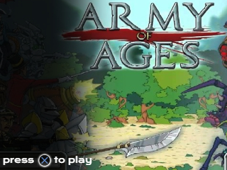
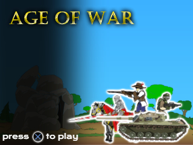
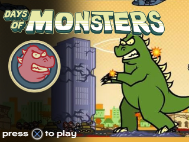
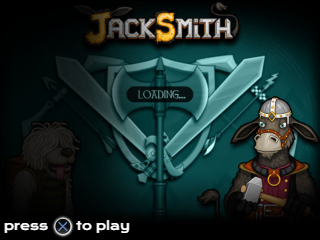
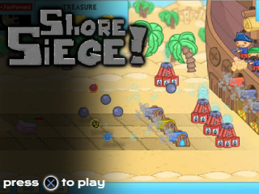

# Supported Games

# Info
Input: PS5 controller only!  
Resolution: 320x240  
using original game sprites and SFX by decompiling the SWF/flash game file  

# Libraries
* pygame  
* dataclasses  
* math  
* sys  
* random  
* PS5 (custom, pygame-based)  